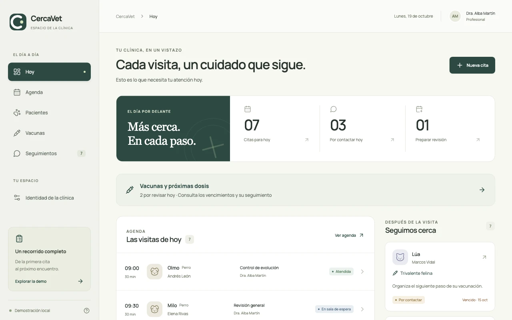

# CercaVet

**English** · [Español](README.es.md)

A white-label workspace for veterinary clinics, built around one loop: **appointment → consultation → follow-up → return visit**. "CercaVet" is the product name and every patient is fictional; each clinic configures its own identity.

[Live demo](https://veterinaria.eilvi.com/) · [Landing for clinics](https://veterinaria.eilvi.com/clinicas/) · [Brand guide](https://veterinaria.eilvi.com/brand/)



The demo interface is in Spanish (it was designed with a clinic in Venezuela). It uses fictional data stored only in each visitor's browser: no accounts, no server, and no real messages are sent.

## Engineering focus

- **Linked records.** Finishing a consultation creates exactly one follow-up; booking a return visit links it back to the follow-up and the original consultation. Cancelling or a no-show reopens the follow-up.
- **Explicit workflow transitions.** The domain layer takes a state and returns the next one, so the rules don't depend on storage and a future API won't force a rewrite.
- **Scheduling rules.** Overlaps and duplicates are blocked per vet and working hours.
- **Vaccinations.** Next-dose due dates share the same follow-up flow. Corrections require a reason and keep the previous values.
- **White label.** Name, logo, palette, contact details, browser title and favicon change per clinic. Messages already recorded keep their historical content.
- **Tested.** 32 tests covering the workflow, identity, data migration, dates, duplicates and link preservation. Every push to `main` runs the tests and deploys to GitHub Pages.

## Run locally

Requires Node.js 22.18+ and npm.

```bash
npm ci
npm run dev
```

Open http://127.0.0.1:5187. To verify and build:

```bash
npm test
npm run build
```

## Current limits

One clinic per installation, no authentication or roles, simulated messaging, and browser-only storage. Production still needs authentication, per-clinic permissions, change history, backup/restore and traceable messaging. The full list, the roadmap and the launch QA report (five user profiles, October 2026) are in the [Spanish README](README.es.md).
